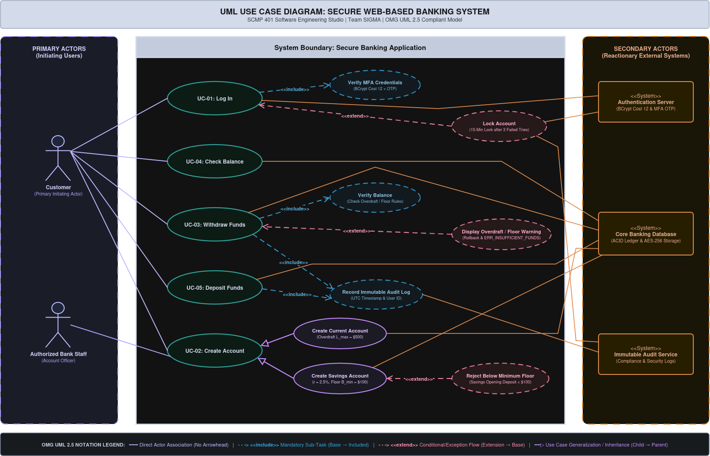

# SOFTWARE REQUIREMENTS SPECIFICATION (SRS)
**Project:** Secure Banking Application | **Course:** SCMP 401 Software Engineering Studio

| Field | Details |
| :--- | :--- |
| **Team Name:** | Team SIGMA |
| **Date & Version:** | 2026-11-11 \| Version 1.0 (Milestone 1 Submission) |
| **Document Authors:** | Natheer Nihad (Product Owner), Ahmed Adil (ScrumMaster), Ahmed Emad & Honyar Bahir (System Architect & Security Lead), Lawand Bestoon (UI/UX Developer), Bavin Kawa & Ahmed Emad (Database & Back-End Lead) |
| **Course & Instructor:** | SCMP 401 — Software Engineering Studio \| Dr. Bestoon Hussien |
| **Document Standard:** | Adapted from IEEE 830-1998 & Ian Sommerville Chapter 4 |

---

## Document Preface & Revision History

This Software Requirements Specification (SRS) outlines the functional, non-functional, and system requirements for the Secure Banking Application developed as part of SCMP 401. It serves as the primary technical agreement between project stakeholders, system architects, software developers, and quality assurance engineers.

| Version | Date | Description of Changes | Author(s) | Approved By |
| :--- | :--- | :--- | :--- | :--- |
| v0.1 | 2026-10-28 | Initial draft of User Requirements & System Scope | Natheer Nihad, Lawand Bestoon | Natheer Nihad (Product Owner) |
| v0.5 | 2026-11-04 | Added System Requirements, Account Logic & NFR Metrics | Ahmed Emad, Bavin Kawa | Ahmed Adil (ScrumMaster) |
| v1.0 | 2026-11-11 | Complete Phase 1 SRS with System Specs, Use Case Tables & RTM | Honyar Bahir, Team SIGMA | Dr. Bestoon Hussien |

---

## 1. Introduction & System Vision

### 1.1 Purpose of the System
This document defines the functional, non-functional, and detailed system requirements for the Secure Web-Based Banking Application developed by Team SIGMA. The system provides authenticated bank customers with secure digital access to manage financial accounts, perform real-time balance inquiries, and execute atomic monetary deposits and withdrawals. It serves as the foundational technical specification for Milestone 1 of the SCMP 401 Software Engineering Studio project.

### 1.2 Scope & System Boundary
The Banking Application encompasses multi-factor customer identity verification, account management (specifically differentiating Current Accounts with overdraft privileges from Savings Accounts with monthly interest calculation and minimum balance floors), real-time balance inquiries, and atomic transaction processing. Functions outside this software boundary (such as physical ATM hardware maintenance, manual vault management, or credit underwriting) are explicitly excluded.

### 1.3 Definitions, Acronyms, and Abbreviations
- **SRS:** Software Requirements Specification — formal document specifying software capabilities.
- **NFR:** Non-Functional Requirement — whole-system quality attributes and operational constraints.
- **MFA:** Multi-Factor Authentication — security verification requiring two or more authentication factors.
- **Current Account:** A transactional deposit account permitting frequent withdrawals and overdraft privileges.
- **Savings Account:** An interest-bearing deposit account subject to transaction frequency and balance minimums.
- **TDD:** Test-Driven Development — engineering practice where unit tests are written prior to code.
- **ACID:** Atomicity, Consistency, Isolation, Durability — database transaction properties ensuring financial operations complete indivisibly or roll back completely.
- **AES-256 & BCrypt:** Cryptographic algorithms used to encrypt stored financial records at rest (AES-256) and hash user passwords with a work factor of 12 (BCrypt).

---

## 2. Stakeholders & Reader Perspectives

Different stakeholders read the SRS for distinct purposes across the Software Development Life Cycle (SDLC):

| Reader Category | Primary Stakeholders | Document Purpose & Focus |
| :--- | :--- | :--- |
| **Client Managers** | Course Instructor (Dr. Bestoon Hussien), Evaluators | Verifies that the system meets educational, architectural, and business objectives. |
| **System End-Users** | Bank Customers, Bank Tellers | Reads User Requirements (UR-1 to UR-5) to confirm system capabilities and daily workflow usability. |
| **System Architects & Developers** | Team SIGMA Engineering Team (4th-Year Computer Engineering) | Uses System Requirements (SR-1.1 to SR-3.3) as an unambiguous technical blueprint for TypeScript (Node.js / NestJS / Express) implementation. |
| **System Test Engineers** | Quality Assurance Lead, Automated TypeScript (Jest) Test Suite | Designs automated unit, integration, and acceptance test cases directly from verifiable specifications. |
| **Agile Project Leads** | Product Owner (Natheer Nihad), ScrumMaster (Ahmed Adil) | Uses specifications to prioritize the Product Backlog, plan sprints, and track requirements traceability. |

---

## 3. User Requirements Definition

User requirements describe the functional services and operational constraints provided to end-users in high-level natural language. Mandatory services use 'shall'; optional enhancements use 'should'.

- **UR-1 [Security & Authentication]:** The Banking Application **shall** authenticate customers using multi-factor credentials (User ID, password, and one-time passcode) before granting access to account services, and **shall** temporarily lock accounts after repeated failed login attempts.
  * *Rationale:* Protects customer financial assets against unauthorized access and complies with data privacy legislation.
- **UR-2 [Account Creation & Types]:** The system **shall** enable authorized personnel or authenticated customers to establish both Current Accounts (supporting overdraft privileges) and Savings Accounts (supporting monthly interest accrual and minimum balance rules).
  * *Rationale:* Provides product differentiation tailored to diverse customer transactional and savings needs.
- **UR-3 [Balance & Ledger Inquiry]:** Authenticated customers **shall** be able to view real-time account balances, available overdraft or withdrawal limits, and recent transaction histories across their Current and Savings accounts.
  * *Rationale:* Gives customers immediate visibility into their financial position before initiating transfers or withdrawals.
- **UR-4 [Monetary Deposit]:** Authenticated customers **shall** be able to deposit positive monetary amounts into an active Current or Savings account with immediate balance updates and digital receipt confirmation.
  * *Rationale:* Ensures reliable crediting of customer funds with an auditable ledger record.
- **UR-5 [Monetary Withdrawal]:** Authenticated customers **shall** be able to withdraw funds from an active Current or Savings account, provided the requested amount satisfies account-specific overdraft limits or minimum balance floors.
  * *Rationale:* Prevents unapproved over-drafting while enforcing bank liquidity and account policy constraints.

---

## 4. Detailed System Requirements Specification

System requirements expand user requirements into explicit technical statements detailing exact inputs, outputs, preconditions, postconditions, and exception handling logic.

### 4.1 Authentication & Access Control
- **SR-1.1 [Credential Hashing & MFA Verification]:** Upon user login, the system **shall** prompt for User ID, Password, and a Multi-Factor Authentication (MFA) one-time passcode. Passwords **shall** be salted and hashed using BCrypt (cost factor 12) prior to verification against the authentication database.
- **SR-1.2 [Brute-Force Lockout Policy]:** If three (3) consecutive incorrect password or MFA attempts are detected within 5 minutes, the system **shall** lock the account for 15 minutes, block subsequent login attempts during the lockout window, and issue a security audit log.

### 4.2 Account Management Logic
- **SR-2.1 [Current Account Overdraft]:** The system **shall** permit negative balances on Current Accounts up to a pre-configured overdraft limit L_max = $500.00. Any withdrawal that would result in a Current Account balance below -$500.00 **shall** be rejected.
- **SR-2.2 [Savings Account Interest]:** The system **shall** calculate and credit monthly interest accrued on active Savings Accounts using I = B * (r / 12) on the last calendar day of each month, where B is the minimum daily balance recorded during the month and r = 2.5%.
- **SR-2.3 [Savings Balance Floor]:** The system **shall** reject withdrawal requests on Savings Accounts if the resulting balance falls below the minimum required balance B_min = $100.00. Savings Accounts **shall not** permit overdrafts (L_max = $0.00).

### 4.3 Transaction Processing Logic
- **SR-3.1 [Atomic Withdrawal Processing Specification]:**
  * **Preconditions:** Customer authenticated; Account status = `ACTIVE`; Session token valid.
  * **Input:** Account ID, Withdrawal Amount (A > $0.00, precision to two decimal places).
  * **Processing Action:** Within an atomic database transaction, the system checks if (Balance_old + L_max) >= A for a Current Account (where L_max = $500.00) or if (Balance_old - A) >= B_min for a Savings Account (where B_min = $100.00). If satisfied, deduct A from Balance_old and append an immutable debit record to the database ledger.
  * **Postconditions:** Updated Balance_new = Balance_old - A; immutable audit log committed; system dispatches withdrawal acknowledgment.
  * **Exception Handling:** If balance or floor constraints are violated, the transaction is aborted, database state rolls back completely, and the system returns `ERR_INSUFFICIENT_FUNDS`.

- **SR-3.2 [Atomic Deposit Processing Specification]:**
  * **Preconditions:** Customer authenticated; Account status = `ACTIVE`; Session token valid.
  * **Input:** Account ID, Deposit Amount (D > $0.00, precision to two decimal places).
  * **Processing Action:** Within an atomic database transaction, the system validates D > $0.00, computes Balance_new = Balance_old + D, updates the account record in the Core Banking Database, and appends an immutable credit record to the transaction ledger.
  * **Postconditions:** Updated Balance_new = Balance_old + D; immutable audit log entry committed; deposit confirmation receipt returned.
  * **Exception Handling:** If D <= $0.00 or a database write error occurs, the transaction is aborted, uncommitted state rolls back, and the system returns `ERR_INVALID_DEPOSIT_AMOUNT`.

- **SR-3.3 [Real-Time Balance Inquiry Specification]:**
  * **Preconditions:** Customer authenticated; Session token valid; Customer authorized to access Account ID.
  * **Input:** Account ID.
  * **Processing Action:** System executes a read-consistent query against the Core Banking Database to retrieve current balance B, account type (`CURRENT` or `SAVINGS`), effective available withdrawal limit, and recent ledger entries.
  * **Postconditions:** Account balance remains unchanged (read-only query); formatted account summary is returned to the client interface within < 1.5 seconds.
  * **Exception Handling:** If the session token has expired or access is unauthorized, the query is rejected with `ERR_UNAUTHORIZED_ACCESS` and the user is redirected to Log In.

---

## 5. Non-Functional Requirements & Metrics

Non-functional requirements specify whole-system properties and operational constraints. They are categorized into Product, Organizational, and External requirements and defined using quantitative, testable metrics.

| NFR Category | Metric Property | Target Quantitative Requirement | Validation Method |
| :--- | :--- | :--- | :--- |
| **Product (Security - Transit)** | Network Encryption | All network traffic between client and server shall use TLS 1.3 encryption. | Wireshark Network Audit |
| **Product (Security - Storage)** | Data & Password Cryptography | Account data at rest shall be encrypted using AES-256; user passwords shall be hashed via BCrypt (cost factor 12). | Database & Security Unit Tests |
| **Product (Speed)** | Response Time | Balance inquiries and atomic transactions shall complete in < 1.5 seconds under a load of 50 concurrent requests. | Apache JMeter Load Test |
| **Product (Availability)** | System Uptime | Operational availability shall be >= 99.9% during scheduled banking hours. | Server Uptime Monitor Logs |
| **Organizational** | CI/CD & Dev Process | All feature branches shall pass automated TypeScript (Jest) unit tests and receive peer review prior to PR merge into `develop` or `main`. | GitHub Actions CI Pipeline |
| **External (Legal)** | Audit Trail | Every monetary transfer and login lockout shall append an immutable log entry with UTC timestamp, User ID, Account ID, and amount. | Database Audit Review |

---

## 6. Graphical Models & Tabular Use Case Specification

Section 6 defines the interaction boundaries between Primary Actors (Customer) and Secondary Actors (Authentication Server and Core Banking Database). Figure 6.1 illustrates the system-level UML Use Case Diagram, followed by detailed tabular specifications for all five core use cases (UC-01 through UC-05).

### Use Case UC-01: Log In
| Field | Specification |
| :--- | :--- |
| **Use Case ID & Name:** | **UC-01: Log In** |
| **Primary Actor:** | Customer (Left-hand initiating user) |
| **Secondary Actor:** | Authentication Server (Right-hand reactionary system) |
| **Description:** | Authenticates a customer using User ID, BCrypt-verified password, and MFA one-time passcode before granting session access. |
| **Preconditions:** | Customer holds a registered account; Account status is not `LOCKED`; TLS 1.3 connection is active. |
| **Main Success Scenario:** | 1. Customer enters User ID and Password. 2. System hashes password with BCrypt (cost factor 12) and verifies credentials against Authentication Server. 3. System executes *Verify MFA Credentials* (`<<include>>`) by validating the one-time passcode. 4. System issues an encrypted session token and loads the account dashboard. |
| **Extensions (`<<extend>>`):** | 2a. *Invalid Password or MFA (< 3 attempts):* System increments failure counter and prompts user to retry. 2b. *Three Consecutive Failed Attempts within 5 Minutes:* System triggers *Lock Account* (`<<extend>>`), locks account for 15 minutes, and records a security audit log. |
| **Postconditions:** | Authenticated session token is active, or account is locked for 15 minutes with an audit entry. |

### Use Case UC-02: Create Account
| Field | Specification |
| :--- | :--- |
| **Use Case ID & Name:** | **UC-02: Create Account** |
| **Primary Actor:** | Authenticated Customer / Authorized Bank Staff (Left-hand initiating user) |
| **Secondary Actor:** | Core Banking Database (Right-hand reactionary system) |
| **Description:** | Establishes a new Current Account or Savings Account (via Use Case Generalization) linked to the authenticated customer profile. |
| **Preconditions:** | User is authenticated; identity verification is complete; session token is active. |
| **Main Success Scenario:** | 1. User selects specialized account type: *Create Current Account* or *Create Savings Account*. 2. For a Current Account, system configures overdraft limit L_max = $500.00. 3. For a Savings Account, system configures monthly interest rate r = 2.5% (I = B * (r / 12)), minimum balance floor B_min = $100.00, and L_max = $0.00. 4. System validates the opening balance and persists the new `ACTIVE` account in the Core Banking Database. |
| **Extensions (`<<extend>>`):** | 4a. *Initial Savings Deposit Below $100.00:* System triggers *Reject Below Minimum Floor* (`<<extend>>`), rejects creation with `ERR_MIN_BALANCE_FLOOR`, and prompts for a valid opening deposit. |
| **Postconditions:** | New Current or Savings account record is persisted in the database with status = `ACTIVE`. |

### Use Case UC-03: Withdraw Funds
| Field | Specification |
| :--- | :--- |
| **Use Case ID & Name:** | **UC-03: Withdraw Funds** |
| **Primary Actor:** | Authenticated Customer (Left-hand initiating user) |
| **Secondary Actor:** | Core Banking Database / Core Ledger System (Right-hand reactionary system) |
| **Description:** | Customer requests an atomic monetary withdrawal from a designated Current or Savings account. |
| **Preconditions:** | User is successfully authenticated; session token is active; Account status = `ACTIVE`. |
| **Main Success Scenario:** | 1. Customer selects target account and enters withdrawal amount A > $0.00. 2. System executes *Verify Balance* (`<<include>>`) against Current Account overdraft limit (L_max = $500.00) or Savings Account minimum floor (B_min = $100.00). 3. System deducts amount A (Balance_new = Balance_old - A) within an atomic transaction. 4. System executes *Record Immutable Audit Log* (`<<include>>`), updates the database ledger, and dispatches withdrawal confirmation. |
| **Extensions (`<<extend>>`):** | 2a. *Insufficient Funds or Floor Breach:* System triggers *Display Overdraft / Floor Warning* (`<<extend>>`), aborts transaction, rolls back database state, and returns `ERR_INSUFFICIENT_FUNDS`. 1a. *Invalid Auth:* Session expires -> System redirects to *Log In* (`<<include>>`). |
| **Postconditions:** | Account balance is atomically updated; immutable debit transaction audit log is recorded. |

### Use Case UC-04: Check Balance
| Field | Specification |
| :--- | :--- |
| **Use Case ID & Name:** | **UC-04: Check Balance** |
| **Primary Actor:** | Authenticated Customer (Left-hand initiating user) |
| **Secondary Actor:** | Core Banking Database (Right-hand reactionary system) |
| **Description:** | Customer queries real-time balance, available withdrawal capacity, and recent ledger entries for a selected Current or Savings account. |
| **Preconditions:** | User is successfully authenticated; session token is active; Account status = `ACTIVE`. |
| **Main Success Scenario:** | 1. Customer selects an active Current or Savings account from the dashboard. 2. System queries the Core Banking Database for current balance B, applicable account constraints (L_max or B_min), and recent transactions. 3. System renders the formatted balance summary within < 1.5 seconds. |
| **Extensions (`<<extend>>`):** | 1a. *Session Expired:* System rejects query with `ERR_UNAUTHORIZED_ACCESS` and redirects to *Log In* (`<<include>>`). |
| **Postconditions:** | Current balance and ledger history are displayed to the customer with no modification to account state. |

### Use Case UC-05: Deposit Funds
| Field | Specification |
| :--- | :--- |
| **Use Case ID & Name:** | **UC-05: Deposit Funds** |
| **Primary Actor:** | Authenticated Customer (Left-hand initiating user) |
| **Secondary Actor:** | Core Banking Database / Core Ledger System (Right-hand reactionary system) |
| **Description:** | Customer executes an atomic monetary deposit into a designated active Current or Savings account. |
| **Preconditions:** | User is successfully authenticated; session token is active; Account status = `ACTIVE`. |
| **Main Success Scenario:** | 1. Customer selects target account and enters deposit amount D > $0.00. 2. System validates that D is a positive monetary value. 3. System computes Balance_new = Balance_old + D and updates the account balance within an atomic database transaction. 4. System executes *Record Immutable Audit Log* (`<<include>>`) and displays a deposit confirmation receipt. |
| **Extensions (`<<extend>>`):** | 2a. *Invalid Deposit Amount (D <= $0.00):* System rejects input and returns `ERR_INVALID_DEPOSIT_AMOUNT`. 3a. *Database Write Failure:* System aborts transaction, rolls back state, and returns `ERR_TX_ROLLBACK`. |
| **Postconditions:** | Account balance is atomically incremented by D; immutable credit transaction audit log is recorded. |

---

## 7. Requirements Traceability & Change Control

Requirements traceability links high-level user needs to detailed system specifications and automated unit tests. Change management governs how evolving requirements are evaluated, approved, and tracked.

| User Requirement | System Requirement | UML Use Case | Automated TypeScript Test (Jest) |
| :--- | :--- | :--- | :--- |
| **UR-1 [Security & Authentication]** | SR-1.1, SR-1.2 | UC-01: Log In | `AuthenticationLogic.spec.ts` |
| **UR-2 [Account Creation & Types]** | SR-2.1, SR-2.2, SR-2.3 | UC-02: Create Account | `AccountCreation.spec.ts` |
| **UR-3 [Balance & Ledger Inquiry]** | SR-3.3 | UC-04: Check Balance | `BalanceInquiry.spec.ts` |
| **UR-4 [Monetary Deposit]** | SR-3.2 | UC-05: Deposit Funds | `DepositAtomic.spec.ts` |
| **UR-5 [Monetary Withdrawal]** | SR-3.1, SR-2.1, SR-2.3 | UC-03: Withdraw Funds | `WithdrawalAtomic.spec.ts` |

### 7.1 Formal Change Management Pipeline
1. **Problem Analysis:** Any proposed requirement modification or defect report is logged as a GitHub Issue and reviewed by the Product Owner to verify business validity.
2. **Change Analysis & Costing:** The System Architect and Database Lead trace affected downstream System Requirements (SR), UML Use Cases (UC), and TypeScript (Jest) unit tests using the RTM above to assess ripple effects and sprint effort.
3. **Change Implementation:** Approved changes are implemented on an isolated `feature/*` branch, verified against automated TypeScript (Jest) test suites in the GitHub Actions CI pipeline, and merged into `develop` via peer-reviewed Pull Request.
